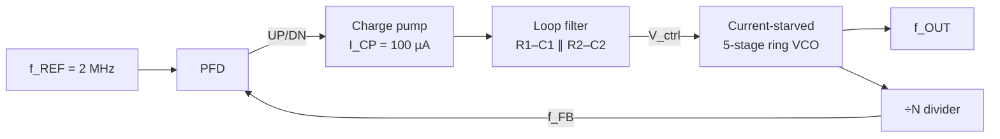

# EN4431 — Analog IC Design: Integer-N PLL in SKY130

Design of a **second-order Type-II integer-N charge-pump phase-locked loop** in the SkyWater
**SKY130** open-source process (1.8 V), from hand analysis and schematic simulation to a
DRC-checked integrated layout aimed at the **Tiny Tapeout TTSKY26c** shuttle
(area budget < 160 µm × 225 µm).



## Contents

| Folder | Description |
|---|---|
| [`docs/task_sheets/`](docs/task_sheets/) | Assignment briefs A1–A4 |
| [`reports/`](reports/) | My submitted reports A1–A4 |
| [`cadence/PLL_421E/`](cadence/) | Cadence Virtuoso library — schematics, symbols and ADE testbenches of every block |
| [`physical_verification/`](physical_verification/) | Pegasus/PVS DRC & LVS run directories, exported GDS, CDL/SPICE netlists |
| [`netlists/`](netlists/) | Stand-alone Spectre netlists |

## A1 — Current-starved ring VCO &nbsp;([brief](docs/task_sheets/A1_Task_Sheet.pdf) · [report](reports/A1_Ring_VCO_Report_210421E.pdf))

* **Theory:** Barkhausen criterion for odd-stage rings, f<sub>osc</sub> = 1/(2N·t<sub>d</sub>), delay vs. V<sub>ctrl</sub>
  of a current-starved stage, H<sub>VCO</sub>(s) = K<sub>VCO</sub>/s, LC-tank resonance & negative-resistance
  start-up (g<sub>m</sub>R<sub>p</sub> ≥ 2), ring-vs-LC comparison.
* **Design:** N = 5 stages (≈ 1 ns stage delay at 100 MHz), C<sub>load</sub> = 50 fF, L = 350 nm devices.
  The final version adds a resistor-degenerated bias (Baker) so I<sub>D</sub> ∝ V<sub>ctrl</sub> → a more linear tuning curve.

| Metric | Initial design (`VCRO`) | Final design (`Linear_VCRO`) |
|---|---:|---:|
| f at V<sub>ctrl</sub> = 0.9 V | 99.8 MHz | **101.4 MHz** |
| Tuning range (linear region) | 50 – 150 MHz | **36.9 – 168.9 MHz** |
| K<sub>VCO</sub> | 425.5 MHz/V (2.67 Grad/s/V) | **217.8 MHz/V (1.369 Grad/s/V)** |
| Average power @ ~100 MHz | 154.9 µW | 360.1 µW |

Also: transient start-up, f–V<sub>ctrl</sub> sweep, FFT spectrum, PSS + PNoise phase-noise simulation.

## A2 — Integer-N PLL analysis & schematic design &nbsp;([brief](docs/task_sheets/A2_Task_Sheet.pdf) · [report](reports/A2_IntegerN_PLL_Report_210421E.pdf))

* **Analysis:** K<sub>PD</sub> = I<sub>CP</sub>/2π = 15.9 µA/rad, 2nd-order loop filter
  F(s) = (1 + sτ<sub>z</sub>) / [sC<sub>tot</sub>(1 + sτ<sub>p</sub>)], open-loop G(s), φ<sub>m</sub> = atan(ω<sub>c</sub>τ<sub>z</sub>) − atan(ω<sub>c</sub>τ<sub>p</sub>),
  optimum ω<sub>c</sub> = 1/√(τ<sub>z</sub>τ<sub>p</sub>), required C<sub>tot</sub>, closed-loop H(s) = N·G/(N + G).
* **Loop filter** (N = 50, f<sub>c</sub> = 180 kHz, φ<sub>m</sub> = 65°):

| τ<sub>z</sub> | τ<sub>p</sub> | C<sub>tot</sub> | C1 | C2 | R1 | R2 |
|---:|---:|---:|---:|---:|---:|---:|
| 3.988 µs | 0.196 µs | 3.001 nF | 2.728 nF | 272.8 pF | 1.462 kΩ | 718 Ω |

* **Blocks:** DFF-based tri-state PFD with reset (SKY130 `sky130_scl_9T_LP` cells), current-steering charge pump,
  passive loop filter, A1 VCO, fixed feedback divider.
* **Closed loop:** with a 2 MHz reference the PLL locks at **127.9993 MHz** (fixed ÷64 in the report);
  lock behaviour, control-voltage settling and output FFT are shown in the report.
* Proposed improvement: programmable / pulse-swallow divider for the full 25 ≤ N ≤ 75 (50–150 MHz) range.

## A3 — Block-wise layout (group work) &nbsp;([brief](docs/task_sheets/A3_Task_Sheet.pdf) · [report](reports/A3_Blockwise_Layout_Report_210421E.pdf))

| Team | Block | Members |
|---|---|---|
| 1 | Phase-frequency detector | Sajitha, Jazoole |
| **2** | **Charge pump + VCO** | **Imasha (layout, DRC), Charles (LVS)** |
| 3 | Divider | Lohan, Erandee |

My contribution: full layout of the **charge pump** and the **current-starved ring VCO** — placement,
routing, supply/bias distribution and DRC clean-up to a **DRC-clean** state. Planned refinements:
common-centroid current mirrors, compaction, SKY130-compatible guard rings, PEX + post-layout simulation.

## A4 — Integrated PLL layout &nbsp;([brief](docs/task_sheets/A4_Task_Sheet.pdf) · [report](reports/A4_Integrated_Layout_Report_210421E.pdf))

Top cell `PLL` (pins `vref`, `vfvout`, `C1`, `C2`, `VDD!`, `VSS!`) integrating the block hard-IPs:
`PFD`, `Charge_Pump`, `Current_trarved_ring_VCO`, `freq_div` and two loop-filter resistors;
the nF-range loop-filter capacitors are **off-chip** (pins `C1`, `C2`) to save area and allow tuning.

* Floorplan: PFD next to CP (short UP/DN), CP next to the loop filter, filter next to the VCO control input,
  VCO kept away from digital routing.
* Loop-filter resistor options:

| Resistor type | DRC | LVS | Approx. layout size |
|---|:---:|:---:|---|
| High-resistivity poly | ✗ | ✓ | 75 × 110 µm = 8 250 µm² |
| Generic poly / diffusion (`res_generic_pd`) | ✓ | ✗ | – |
| Metal1 serpentine (submitted) | ✓ | ✗ | 165 × 80 µm = 13 200 µm² |

  Both fit the 160 × 225 µm budget; the poly version would be ≈ 37 % smaller.
  The LVS mismatch is traced to the schematic auCdl netlisting `res_generic_pd` with a body terminal
  (`$SUB=VDD!`) while the extraction template is two-terminal.
* PVS DRC on the exported layouts (`physical_verification/drc/*.sum`): **0 results** for
  `PLL`, `PFD`, `Charge_Pump`, `Current_trarved_ring_VCO`, `freq_div` and `inv` (578 rule checks).
* Note: the integrated `freq_div` netlist (`physical_verification/lvs/PLL.cdl`) is a ÷3 → ÷4 → ÷4 chain, i.e. **÷48**
  (96 MHz at lock with the 2 MHz reference), matching the `DIV_BY_48` schematic used in `PLL_TB`.

## Opening the Virtuoso library

1. Install the SKY130 Cadence PDK and the `sky130_scl_9T_LP` standard-cell library.
2. Add to your `cds.lib`:
   ```
   DEFINE PLL_421E <path-to-repo>/EN4431_Analog_IC_Design/cadence/PLL_421E
   ```
3. Testbench model includes point to `.../sky130_release_0.1.0/models/sky130.lib.spice` (tt corner);
   update the path in ADE to match your installation.

See [`cadence/README.md`](cadence/README.md) for a cell-by-cell description.

## References

* R. J. Baker, *CMOS: Circuit Design, Layout, and Simulation*, 3rd ed., Wiley, 2010.
* B. Razavi, *Design of Analog CMOS Integrated Circuits* and *RF Microelectronics*.
* N. F. Assaify et al., "A Ring-Oscillator-Based 2.4 GHz Integer-N PLL Design in SkyWater 130nm Open-Source Technology", ISPACS 2025.
* D. Fischette, "Practical Phase-Locked Loop Design", ISSCC 2004 tutorial.
