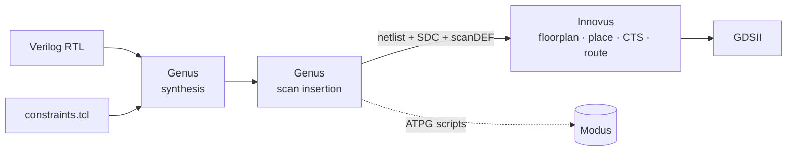

# EN4603 — Digital IC Design

RTL-to-GDSII ASIC implementation with the Cadence digital flow on the **Cadence 45 nm Generic PDK**
(`gsclib045` standard cells, `giolib045` I/O pads).



## Contents

| Folder | Description |
|---|---|
| [`docs/lab_sheets/`](docs/lab_sheets/) | Official handouts for Labs 1–3 |
| [`lab1_synthesis/`](lab1_synthesis/) | Lab 1 — logic synthesis of a dual UART transceiver |
| [`lab2_dft_insertion/`](lab2_dft_insertion/) | Lab 2 — muxed-scan DFT insertion on the same design |
| [`lab3_place_and_route/`](lab3_place_and_route/) | Lab 3 — place & route to GDSII in Innovus |
| [`alu_asic_project/`](alu_asic_project/) | Individual assignment — 8-bit ALU taken through synthesis, DFT and padded P&R |

## Results at a glance

| Design | Stage | Cells | Area (µm²) | Timing | Notes |
|---|---|---:|---:|---|---|
| UART ×2 (32-bit words) | Lab 1 synthesis | 1130 | 5 419 (cell + net) | met (slack +9.1 ns @ 50 MHz) | clocks: 50 MHz, 40 % duty, clk_b 180° shifted |
| UART ×2 | Lab 2 after scan connect | 764 | 3 612 | met | 2 chains × 82 flops |
| UART ×2 | Lab 3 post-route | 765 | 2 544 (std-cell) | setup WNS +3.05 ns, hold WNS +0.002 ns | 0 DRC / connectivity errors |
| 8-bit ALU | synthesis | 184 | 633 | met (slack +5.37 ns @ 100 MHz) | 26 µW |
| 8-bit ALU | after scan connect | 197 | 684 | met | 1 chain × 10 flops |
| 8-bit ALU | sign-off (core only) | 183 | 404 (std-cell) | setup WNS +6.61 ns, hold WNS +0.003 ns | 0 DRC / connectivity errors |

## Folder convention

Every lab/project uses the same layout expected by the lab scripts (all paths are relative, the tools are launched from `work/`):

```
<project>/
├── input/        # RTL (input/rtl), constraints, MMMC .view, pad .io, (libs – not tracked)
├── output/       # generated netlists (.v), SDC, scanDEF, GDS
├── report/       # area / timing / power / port / scan / geometry reports
└── work/         # tool run directory: genus.cmd / innovus.cmd command histories + logs
```

The `genus.cmd` and `innovus.cmd` files are the exact command histories of each run and act as
the reproducible flow scripts.

## Technology libraries

The Cadence GPDK045 libraries are licensed for teaching only and are **not** committed
(`**/input/libs/` is in `.gitignore`). To re-run any flow, copy the library tree from the lab
server into the project you want to run:

```
<project>/input/libs/gsclib045/
├── lef/      gsclib045_tech.lef  gsclib045_macro.lef  gsclib045_multibitsDFF.lef  giolib045.lef
├── timing/   slow_vdd1v0_basicCells.lib  fast_vdd1v0_basicCells.lib  ...
└── qrc/qx/   gpdk045.tch
```

## Running a flow

```bash
cd lab1_synthesis/work
genus -files genus.cmd          # or start genus and source the commands step by step

cd ../../lab3_place_and_route/work
innovus                          # then source innovus.cmd, or follow the lab sheet GUI steps
```
