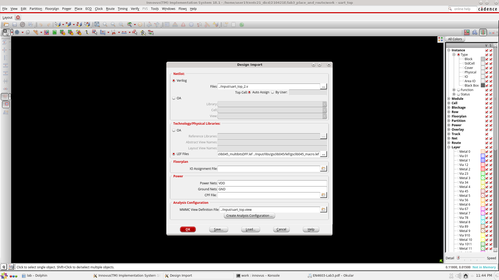

# Lab 3 — Place & Route (Cadence Innovus)

**Handout:** [`../docs/lab_sheets/EN4603-Lab3.pdf`](../docs/lab_sheets/EN4603-Lab3.pdf)

Physical implementation of the scan-inserted dual-UART netlist from Lab 2 down to GDSII.

## Inputs (`input/`)

`uart_top_2.v` (scan netlist), `uart_top_2.sdc`, `uart_top_2_scanDEF.scandef`,
`uart_top.view` (MMMC: slow/fast corners), `streamOut.map` (GDS layer map).

## Flow (`work/innovus.cmd`, `innovus.cmd1`)

Import design → floorplan → power rings & stripes → special route → placement (with/without
pre-place optimisation) → pre-CTS timing/optimisation → **CTS** → post-CTS hold fixing →
NanoRoute → post-route timing in on-chip-variation mode → filler cells → `verifyGeometry` /
`verifyConnectivity` → `streamOut` to GDSII.

## Results

| Checkpoint | Gates | Cells | Std-cell area (µm²) |
|---|---:|---:|---:|
| Placement without pre-place opt. | 2 498 | 764 | 2 562.9 |
| Placement with pre-place opt. (pre-CTS) | 2 300 | 738 | 2 359.8 |
| Post-CTS | 2 479 | 765 | 2 544.1 |

| Analysis | WNS | TNS | Violating paths |
|---|---|---|---|
| Pre-CTS setup | +3.053 ns | 0 | 0 / 514 |
| Post-route hold | +0.002 ns | 0 | 0 / 514 |

* Core density after placement: **36.7 %**
* `report/uart_top.geom.rpt` — **no DRC violations**; `report/uart_top.conn.rpt` — **no connectivity problems**
* Final layout: [`output/uart_top`](output/uart_top) (GDSII stream)

Timing reports: `report/pre_CTS/`, `report/post_CTS/`, `report/post_Route/`, `work/timingReports/`.
